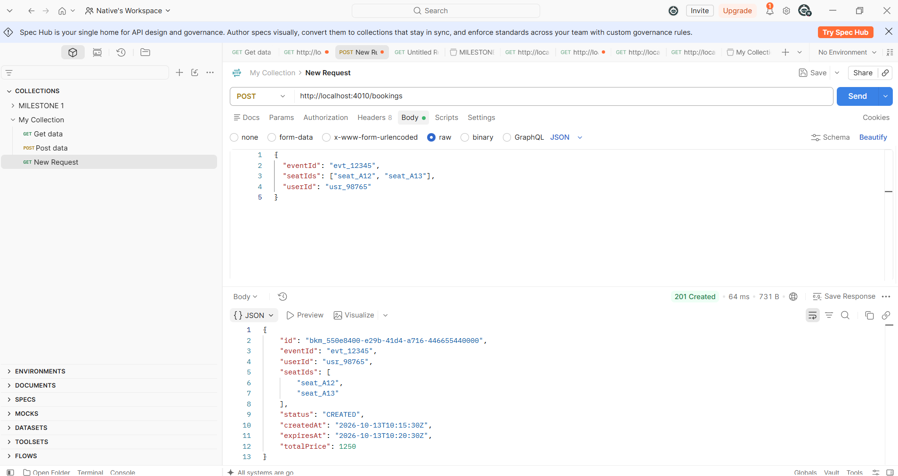
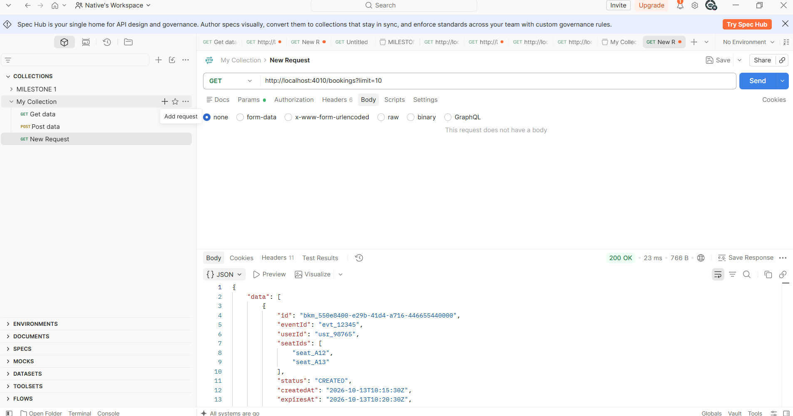
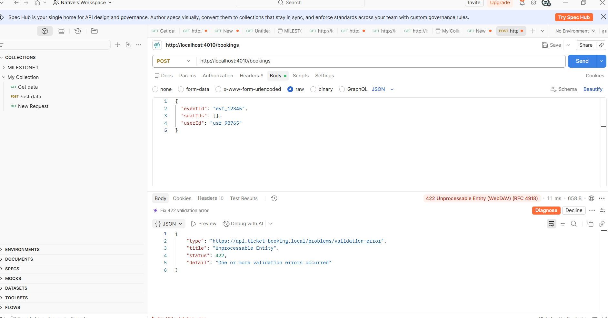

<!-- API-CONTRACT-KhNTU-Lab3-Verified -->

# Звіт про виконання лабораторної роботи №3
## Тема: Проєктування та специфікація API (REST OpenAPI 3.0 та gRPC Proto3)

**Студент:** Калатун Євгеній Володимирович  
**Група:** 2Прс  
**Тег у репозиторії:** lr3  
**Посилання на репозиторій:** https://github.com/Oomg/khntu-software-architecture-lab1-kalatun

### 1. Архітектурне позиціонування інтерфейсів

- **Публічний REST API** (OpenAPI 3.0) — для клієнтів (Web SPA, Mobile). Використовується для операцій створення, перегляду та скасування бронювань.
- **Внутрішній gRPC API** (Proto3) — для високопродуктивної міжсервісної взаємодії всередині Modular Monolith (наприклад, BookingModule ↔ Inventory/Seats).

### 2. Специфікація REST API (OpenAPI 3.0)

Файл: `api/openapi.yaml`

| HTTP Method | Path                      | Опис                          | Коди відповідей      |
|-------------|---------------------------|-------------------------------|----------------------|
| POST        | /bookings                 | Створити бронювання           | 201, 400, 401, 422  |
| GET         | /bookings                 | Список бронювань (пагінація)  | 200, 401            |
| GET         | /bookings/{bookingId}     | Отримати одне бронювання      | 200, 401, 404       |
| PATCH       | /bookings/{bookingId}     | Оновити статус                | 200, 400, 401, 404, 422 |
| DELETE      | /bookings/{bookingId}     | Скасувати бронювання          | 204, 401, 404       |

Усі помилки 4xx/5xx описані за стандартом **RFC 7807** (`application/problem+json`).

**Скріншоти тестування Prism Mock Server:**

  
Рисунок 2.1 – Успішне створення бронювання (201 Created)

  
Рисунок 2.2 – Отримання списку бронювань (200 OK)

  
Рисунок 2.3 – Помилка валідації (422 Unprocessable Entity + Problem Details)

### 3. Специфікація gRPC API (Protocol Buffers v3)

Файл: `api/service.proto`

Сервіс: `BookingInternalService`

RPC-методи:
- `CreateBooking` — Unary
- `GetBookingStatus` — Unary
- `StreamBookingUpdates` — Server Streaming

Використано: `enum BookingStatus`, вкладені повідомлення, `google.protobuf.Timestamp`, поле аудиту.

Згенеровані стаби знаходяться в `api/generated/`.

### 4. Порівняльний аналіз (JSON vs Protobuf)

| Формат            | Розмір (байти) | Коефіцієнт стиснення |
|-------------------|----------------|----------------------|
| JSON (compact)    | ~285           | 1×                   |
| Protobuf (binary) | ~100           | ~2.8×                |

**Висновки щодо компромісів:**
- Protobuf дає значну економію трафіку і швидшу серіалізацію.
- JSON залишається зручнішим для відлагодження та публічних API.
- Proto3 забезпечує хорошу зворотну сумісність завдяки числовим тегам полів.
- gRPC поверх HTTP/2 усуває проблеми head-of-line blocking, характерні для HTTP/1.1.

### 5. Висновки

У ході лабораторної роботи №3 спроєктовано публічний REST-контракт (OpenAPI 3.0.3) та внутрішній gRPC-контракт (Proto3) для системи Online Ticket Booking & Event Platform.

Реалізовано:
- 5 REST-ендпоінтів з повною типізацією, валідацією та RFC 7807;
- Prism Mock Server з успішним тестуванням у Postman;
- gRPC-сервіс з 3 RPC-методами (включаючи streaming);
- порівняльний аналіз розміру корисного навантаження.

Підхід Contract-First дозволив зафіксувати контракти до написання бізнес-коду, що відповідає цілям ПРН17 та ФК03.