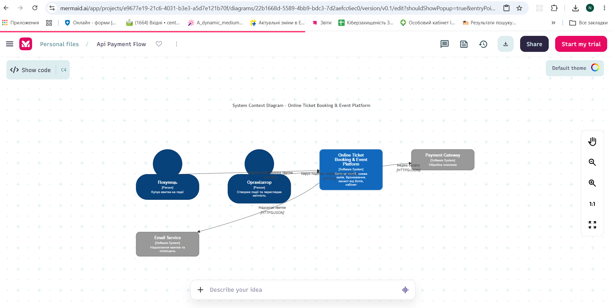
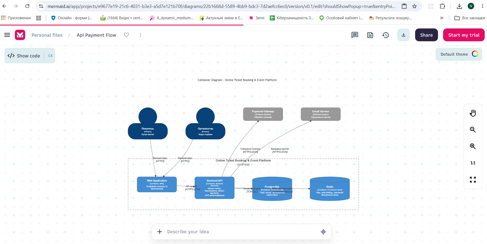
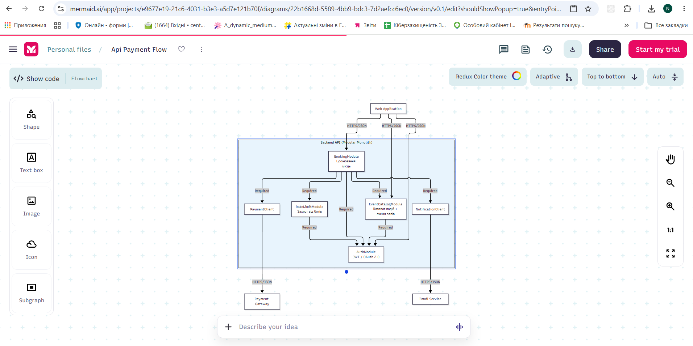
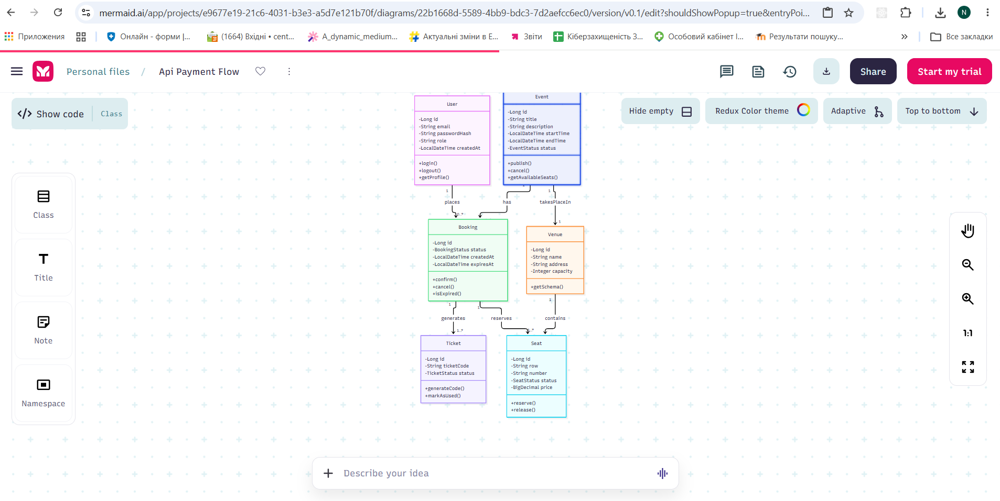
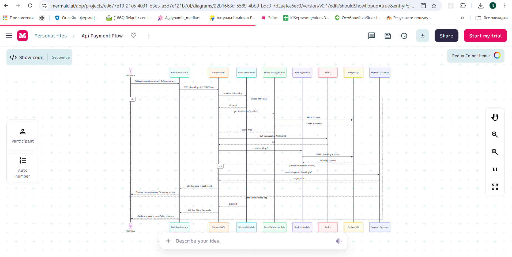
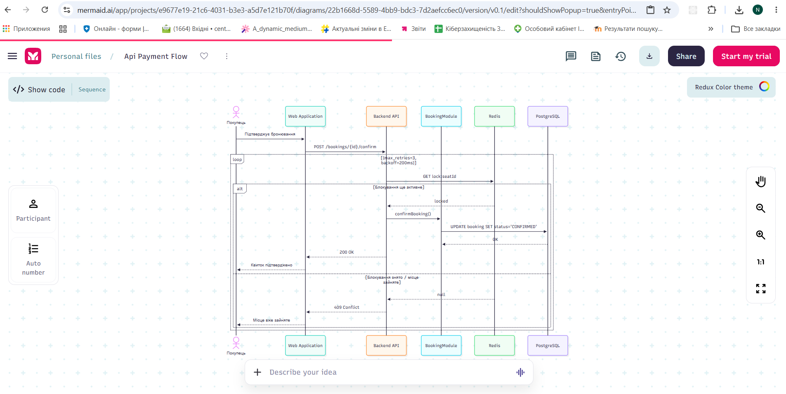
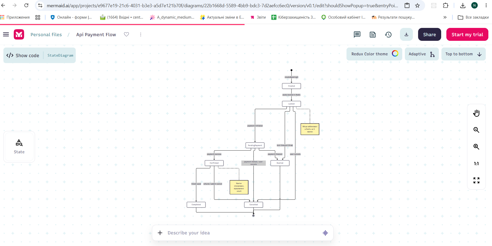

# Звіт з лабораторної роботи №2
## Побудова C4 Model, UML-моделювання статичної структури та динаміки поведінки

**Студент:** Калатун Євгеній Володимирович  
**Група:** 2Прс  
**Варіант:** 4 — Online Ticket Booking & Event Platform  
**Репозиторій:** https://github.com/Oomg/khntu-software-architecture-lab1-kalatun  
**Тег ЛР1:** lr1  
**Тег ЛР2:** lr2 (буде після завершення)

---

## Розділ 1. C4 Model

### 1.1. System Context Diagram (C4 Level 1)

Діаграма показує систему як єдине ціле та її взаємодію зі стейкхолдерами і зовнішніми системами. Межі системи відповідають тим, що були зафіксовані в лабораторній роботі №1.

```mermaid
C4Context
    title System Context Diagram - Online Ticket Booking & Event Platform

    Person(buyer, "Покупець", "Купує квитки на події")
    Person(organizer, "Організатор", "Створює події та переглядає звітність")
    
    System(ticketSystem, "Online Ticket Booking & Event Platform", "Каталог подій, схема залів, бронювання, захист від ботів, кабінет")

    System_Ext(payment, "Payment Gateway", "Обробка платежів")
    System_Ext(email, "Email Service", "Надсилання квитків та сповіщень")

    Rel(buyer, ticketSystem, "Шукає події, бронює квитки", "HTTPS")
    Rel(organizer, ticketSystem, "Керує подіями, переглядає продажі", "HTTPS")
    Rel(ticketSystem, payment, "Ініціює оплату", "HTTPS/JSON")
    Rel(ticketSystem, email, "Надсилає квитки", "HTTPS/JSON")
    
    

**Рисунок 1.1 – C4 System Context Diagram (Level 1)**

### 1.2. Container Diagram (C4 Level 2)

Діаграма показує основні контейнери системи відповідно до архітектурного рішення Modular Monolith (ADR-0001) та стратегії зберігання даних (ADR-0002).

```mermaid
C4Container
    title Container Diagram - Online Ticket Booking & Event Platform

    Person(buyer, "Покупець", "Купує квитки")
    Person(organizer, "Організатор", "Керує подіями")

    System_Boundary(system, "Online Ticket Booking & Event Platform") {
        Container(web, "Web Application", "SPA", "Інтерфейс покупця та організатора")
        Container(api, "Backend API", "Modular Monolith", "Бізнес-логіка, бронювання, захист від ботів, JWT-автентифікація")
        ContainerDb(db, "PostgreSQL", "Relational DB", "Події, місця, бронювання, користувачі")
        ContainerDb(redis, "Redis", "In-memory store", "Кеш, rate-limiting, тимчасові блокування місць")
    }

    System_Ext(payment, "Payment Gateway", "Обробка платежів")
    System_Ext(email, "Email Service", "Надсилання квитків")

    Rel(buyer, web, "Використовує", "HTTPS")
    Rel(organizer, web, "Використовує", "HTTPS")
    Rel(web, api, "API-запити", "HTTPS/JSON")
    Rel(api, db, "Читає/пише дані", "TCP/SQL")
    Rel(api, redis, "Кеш, rate-limit, locks", "TCP/Redis Protocol")
    Rel(api, payment, "Створення платежу", "HTTPS/JSON")
    Rel(api, email, "Відправка квитків", "HTTPS/JSON")

 


**Рисунок 1.2 – C4 Container Diagram (Level 2)** 

## Розділ 2. UML Component Diagram та Domain Class Diagram

### 2.1. UML Component Diagram (C4 Level 3)

Діаграма показує внутрішню структуру Backend API (Modular Monolith). Відображені основні модулі та їхні залежності (Required-інтерфейси).



**Рисунок 2.1 – UML Component Diagram (Backend API)**

### 2.2. UML Domain Class Diagram

Діаграма доменної моделі системи. Показані основні сутності, їх атрибути, методи, специфікатори доступу та кратність зв’язків.



**Рисунок 2.2 – UML Domain Class Diagram**

## Розділ 3. UML Sequence Diagram та State Machine Diagram

### 3.1. Sequence Diagram — Успішне бронювання квитка



**Рисунок 3.1 – Sequence Diagram: Успішне бронювання квитка (з alt та opt)**

### 3.2. Sequence Diagram — Підтвердження бронювання з повторними спробами



**Рисунок 3.2 – Sequence Diagram: Підтвердження бронювання (з loop)**

### 3.3. State Machine Diagram — життєвий цикл Booking

Діаграма показує всі можливі стани бронювання та переходи між ними.



**Рисунок 3.3 – State Machine Diagram життєвого циклу сутності Booking**